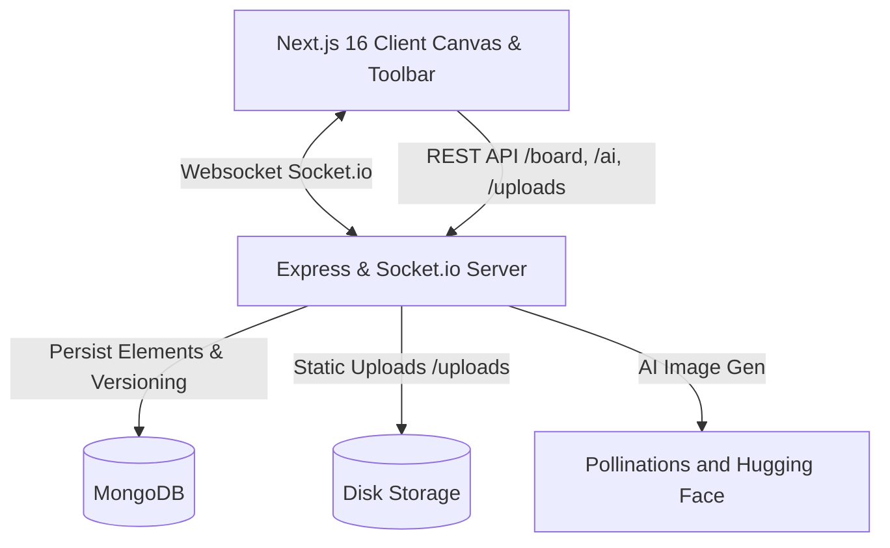

# Canvas Flow

A high-performance, real-time collaborative whiteboard built with Next.js 16, TypeScript, Node.js Express, Socket.io, Zustand, and MongoDB. Features an infinite canvas, multi-user live cursors, presence awareness with follow-mode, heuristic auto-clean shape detection, and AI sketch enhancement.

---

## Architecture Overview



---

## Features

- **Workspace home**: Create a blank board, choose a starter template, open an invite, or reopen a recent board from this browser.
- **Board management**: Owners can rename or delete boards. A renamed board updates for collaborators live.
- **JSON snapshots**: Export a board and restore the snapshot from the home page or the board menu. Import creates a separate board. Image links in a snapshot depend on their original storage.

- **Infinite Canvas**: HTML5 canvas with smooth pan, zoom, pinch-to-zoom, and two-finger mobile touch gestures.
- **Complete Tool Suite**: Pencil, rectangle, circle, line, arrow, multi-line text with dynamic font scaling, image upload, and eraser.
- **Real-Time Collaboration**: Live cursors with server-assigned identities, presence avatars, and **Follow User** mode.
- **Collaborative Undo & Redo**: Broadcasted state transitions keeping all tabs and users in sync.
- **Optimistic Concurrency & Versioning**: Version-controlled saves preventing last-write-wins data loss with 409 conflict detection.
- **Element-Level Operations**: Op-based sync (`POST /board/:id/ops`) avoiding costly whole-document rewrites.
- **Data Integrity**: Strict Mongoose validation, schema support for text, images, custom fills, and font sizes.
- **Smart Image Storage**: Automatic extraction of base64 payloads to static URLs (`/uploads/`), saving database size and bandwidth.
- **AI Sketch Enhancement**: Asynchronous job queue, in-memory caching, rate limiting, and prompt enrichment.
- **Theme Awareness**: Dynamic light/dark theme system with synchronized canvas background and PNG export.

---

## Project Structure

```text
.
├── client/              # Next.js 16 frontend (Canvas, Toolbar, Hooks, Store)
├── server/              # Express + Socket.io backend (Controllers, Sockets, Models)
├── shared/              # Shared TypeScript types package (@shared)
├── scripts/             # Cross-platform development orchestration
├── .github/workflows/   # Automated CI pipeline
├── docker-compose.yml   # Multi-container orchestration (Mongo, Server, Client)
├── IMPROVEMENTS.md      # Action plan and engineering tracking
└── README.md
```

---

## Collaboration Socket Events

The web client batches pointer previews by animation frame and sends only local element changes to autosave. MongoDB stores edits and deletion markers. Keep collaboration on one Socket.IO server instance so all participants share the same live room state.

| Event | Direction | Payload | Description |
|---|---|---|---|
| `identity` | Server → Client | `{ userId, name, color }` | Server assigns distinct identity & color palette |
| `join-board` | Client → Server | `{ boardId }` | User joins board room |
| `leave-board` | Client → Server | `{ boardId }` | User leaves board room |
| `request-state` | Client → Server | `{ boardId }` | Request fresh board state on reconnect |
| `board:state` | Server → Client | `{ elements, version }` | Authoritative board snapshot |
| `presence:join` | Server → Client | `{ boardId, user }` | Notifies room of collaborator arrival |
| `presence:leave`| Server → Client | `{ boardId, userId }` | Notifies room of collaborator departure |
| `presence:state`| Server → Client | `{ boardId, users }` | Current room presence list |
| `cursor-position`| Bidirectional | `{ boardId, cursor }` | Latest cursor position, batched by animation frame |
| `cursor-leave` | Server → Client | `{ boardId, userId }` | Removes remote cursor immediately |
| `draw` | Bidirectional | `{ boardId, element }` | Real-time stroke / element broadcast |
| `update-element`| Bidirectional | `{ boardId, element }` | Element transformation / resize |
| `replace-elements`| Bidirectional | `{ boardId, elements, deletedIds }` | Preview a batch of element changes or deletions |
| `board:committed` | Server → Client | `{ boardId, elements, deletedIds, version }` | Confirm the element changes stored by MongoDB |
| `clear-board` | Bidirectional | `{ boardId }` | Clear board notification |

---

## REST API Reference

| Endpoint | Method | Description |
|---|---|---|
| `POST /board` | POST | Creates a board, optionally with a title and initial elements |
| `GET /board/:id` | GET | Fetches an existing board when the caller has access |
| `PATCH /board/:id` | PATCH | Updates the board title using an owner token |
| `PUT /board/:id` | PUT | Updates board with version checking (returns 409 on conflict) |
| `POST /board/:id/ops` | POST | Applies element-level operations (`add`, `update`, `delete`) |
| `POST /board/upload` | POST | Persists image and returns static `/uploads/...` URL |
| `POST /board/clean` | POST | Heuristic shape recognition (turns rough sketches into geometry) |
| `POST /ai/enhance` | POST | Queues AI sketch enhancement (returns cached URL or `jobId`) |
| `GET /ai/job/:id` | GET | Polls status & progress for queued AI generation |
| `GET /health` | GET | Liveness probe |
| `GET /health/ready` | GET | Readiness probe (verifies MongoDB ping) |

---

## Quickstart & Local Development

### 1. Requirements

- Node.js 22+
- npm 9+
- MongoDB running locally or via Docker

### 2. Environment Setup

Create `server/.env`:
```env
PORT=4001
MONGO_URI=mongodb://127.0.0.1:27017/whiteboard
CLIENT_ORIGIN=http://localhost:3000,http://localhost:3001
HF_TOKEN=your_token_optional
```

#### AI Generation (Optional)

| Variable | Description |
|---|---|
| `POLLINATIONS_API_KEY` | Server-side Pollinations secret key for sketch-guided and text image generation. Set it in the Compose root `.env` when using Docker. |
| `HF_TOKEN` | Server-side Hugging Face token with Inference Providers access. When Pollinations is unavailable, text prompts use FLUX.1-schnell via Hugging Face. Sketches stay on the Pollinations path. Set it in the Compose root `.env` when using Docker. |
| `SKETCH_WORDING` | Optional. Id of a measured wording from `server/src/config/sketchWordings.ts`. Empty means the measured default. |
| `POLLINATIONS_TEXT_MODEL` | Optional model for text pictures with a key (default `flux`). |

The wordings are measured by `server/scripts/sketch-probe4.mjs` (evidence in `docs/ai-evidence/v4/`), and `npm run smoke:image` checks the real route (evidence in `docs/ai-evidence/app/`).

#### Vercel Blob Storage (Preferred; Optional)

> **Note**: Leaving `BLOB_READ_WRITE_TOKEN` unset falls back to S3/local.

| Variable | Description |
|---|---|
| `BLOB_READ_WRITE_TOKEN` | Vercel Blob read/write token for object storage |

#### S3-Compatible Object Storage (Optional)

> **Note**: Leaving `S3_*` variables unset falls back to writing images to local disk in `uploads/` (these will be lost on deploy / ephemeral filesystems like Render).

| Variable | Description |
|---|---|
| `S3_ENDPOINT` | S3-compatible service endpoint URL (optional; for R2, B2, MinIO) |
| `S3_REGION` | S3 region (optional; defaults to `auto` or `us-east-1`) |
| `S3_BUCKET` | S3 bucket name for persisting uploaded images |
| `S3_ACCESS_KEY_ID` | S3 access key ID for authentication |
| `S3_SECRET_ACCESS_KEY` | S3 secret access key for authentication |
| `S3_PUBLIC_BASE_URL` | Public CDN or custom domain URL serving uploaded assets |

Create `client/.env.local`:
```env
NEXT_PUBLIC_API_URL=http://localhost:4001
NEXT_PUBLIC_SOCKET_URL=http://localhost:4001
```

### 3. Run with Docker Compose

Set `BOARD_SECRET` once in the project root's `.env` file. Keep the same value across restarts so board and share links keep working. If the file does not yet contain `BOARD_SECRET`, generate and append one with:

```bash
(umask 077; printf 'BOARD_SECRET=%s\n' "$(openssl rand -hex 32)" >> .env)
docker compose up --build --detach --wait
```

Open the app at `http://localhost:3000`. Compose stores boards and local image uploads in named volumes. For a custom public API or Socket.IO URL, set `NEXT_PUBLIC_API_URL` or `NEXT_PUBLIC_SOCKET_URL` in the root `.env` and rebuild the frontend.

### 4. Run Directly with Node / npm

```bash
# Install dependencies
npm install

# Run cross-platform concurrent dev server
npm run dev

# Run typechecks
npm run typecheck

# Run test suites
npm test
npm run test:collab

# Build production bundle
npm run build
```


With the local client and MongoDB-backed API running, use `node tests/workspace.e2e.mjs` to verify creation, sharing, renaming, downloads, and JSON restore.

With the development client and an isolated MongoDB-backed API running, use `node tests/multi-editor.e2e.mjs` to exercise concurrent browser editing, persistence, reconnect, and share roles. Set `BASE_URL` and `API_URL` if using different ports.

For a production server, set `NODE_ENV=production`, a stable random `BOARD_SECRET`, `MONGO_URI`, and the deployed web origins in `CLIENT_ORIGIN` (comma-separated, with the public invite-link origin first). Check `/health/ready` for MongoDB readiness. The production server returns a storage error during a MongoDB outage so the client can retry unsaved edits.
