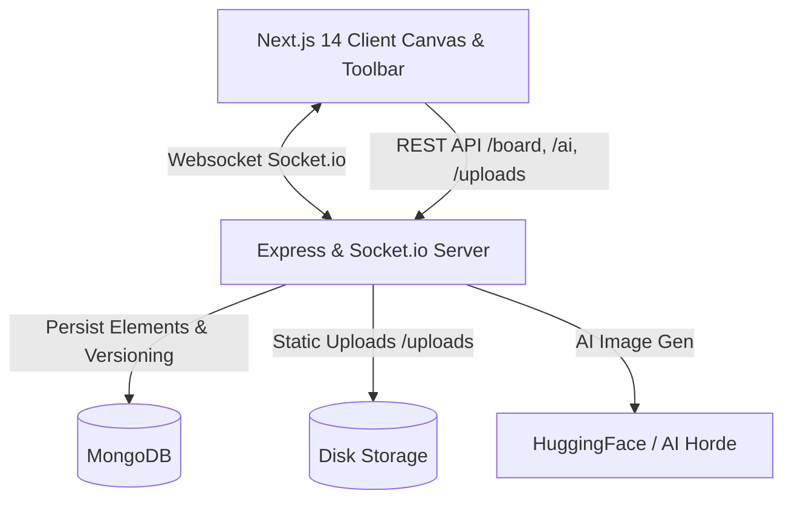

# Whiteboard

A high-performance, real-time collaborative whiteboard built with Next.js 14, TypeScript, Node.js Express, Socket.io, Zustand, and MongoDB. Features an infinite canvas, multi-user live cursors, presence awareness with follow-mode, heuristic auto-clean shape detection, and AI sketch enhancement.

---

## Architecture Overview



---

## Features

- **Infinite Canvas**: Zero-latency HTML5 canvas with smooth pan, zoom, pinch-to-zoom, and two-finger mobile touch gestures.
- **Complete Tool Suite**: Pencil, rectangle, circle, line, arrow, multi-line text with dynamic font scaling, image upload, and eraser.
- **Real-Time Collaboration**: Live cursors with server-assigned identities, presence avatars, and **Follow User** mode.
- **Collaborative Undo & Redo**: Broadcasted state transitions keeping all tabs and users in sync.
- **Optimistic Concurrency & Versioning**: Version-controlled saves preventing last-write-wins data loss with 409 conflict detection.
- **Element-Level Operations**: Op-based sync (`POST /board/:id/ops`) avoiding costly whole-document rewrites.
- **Data Integrity**: Strict Mongoose validation, schema support for text, images, custom fills, and font sizes.
- **Smart Image Storage**: Automatic extraction of base64 payloads to static URLs (`/uploads/`), saving database size and bandwidth.
- **AI Sketch Enhancement**: Asynchronous job queue, in-memory caching, rate limiting, and prompt enrichment.
- **Theme Awareness**: Dynamic light/dark theme system with synchronized canvas background and PNG export.

---

## Project Structure

```text
.
├── client/              # Next.js 14 frontend (Canvas, Toolbar, Hooks, Store)
├── server/              # Express + Socket.io backend (Controllers, Sockets, Models)
├── shared/              # Shared TypeScript types package (@shared)
├── scripts/             # Cross-platform development orchestration
├── .github/workflows/   # Automated CI pipeline
├── docker-compose.yml   # Multi-container orchestration (Mongo, Server, Client)
├── IMPROVEMENTS.md      # Action plan and engineering tracking
└── README.md
```

---

## Collaboration Socket Events

| Event | Direction | Payload | Description |
|---|---|---|---|
| `identity` | Server → Client | `{ userId, name, color }` | Server assigns distinct identity & color palette |
| `join-board` | Client → Server | `{ boardId }` | User joins board room |
| `leave-board` | Client → Server | `{ boardId }` | User leaves board room |
| `request-state` | Client → Server | `{ boardId }` | Request fresh board state on reconnect |
| `board:state` | Server → Client | `{ elements, version }` | Authoritative board snapshot |
| `presence:join` | Server → Client | `{ boardId, user }` | Notifies room of collaborator arrival |
| `presence:leave`| Server → Client | `{ boardId, userId }` | Notifies room of collaborator departure |
| `presence:state`| Server → Client | `{ boardId, users }` | Current room presence list |
| `cursor-position`| Bidirectional | `{ boardId, cursor }` | Throttled cursor position with trailing send |
| `cursor-leave` | Server → Client | `{ boardId, userId }` | Removes remote cursor immediately |
| `draw` | Bidirectional | `{ boardId, element }` | Real-time stroke / element broadcast |
| `update-element`| Bidirectional | `{ boardId, element }` | Element transformation / resize |
| `replace-elements`| Bidirectional | `{ boardId, elements }` | Undo/Redo or batch replace synchronization |
| `clear-board` | Bidirectional | `{ boardId }` | Clear board notification |

---

## REST API Reference

| Endpoint | Method | Description |
|---|---|---|
| `POST /board` | POST | Creates a new board document |
| `GET /board/:id` | GET | Fetches or lazily initializes a board |
| `PUT /board/:id` | PUT | Updates board with version checking (returns 409 on conflict) |
| `POST /board/:id/ops` | POST | Applies element-level operations (`add`, `update`, `delete`) |
| `POST /board/upload` | POST | Persists image and returns static `/uploads/...` URL |
| `POST /board/clean` | POST | Heuristic shape recognition (turns rough sketches into geometry) |
| `POST /ai/enhance` | POST | Queues AI sketch enhancement (returns cached URL or `jobId`) |
| `GET /ai/job/:id` | GET | Polls status & progress for queued AI generation |
| `GET /health` | GET | Liveness probe |
| `GET /health/ready` | GET | Readiness probe (verifies MongoDB ping) |

---

## Quickstart & Local Development

### 1. Requirements

- Node.js 18+
- npm 9+
- MongoDB running locally or via Docker

### 2. Environment Setup

Create `server/.env`:
```env
PORT=4001
MONGO_URI=mongodb://127.0.0.1:27017/whiteboard
CLIENT_ORIGIN=http://localhost:3000,http://localhost:3001
HF_TOKEN=your_token_optional
```

Create `client/.env.local`:
```env
NEXT_PUBLIC_API_URL=http://localhost:4001
NEXT_PUBLIC_SOCKET_URL=http://localhost:4001
```

### 3. Run with Docker Compose

```bash
docker compose up -d
```

### 4. Run Directly with Node / npm

```bash
# Install dependencies
npm install

# Run cross-platform concurrent dev server
npm run dev

# Run typechecks
npm run typecheck

# Run test suite
npm run test

# Build production bundle
npm run build
```
