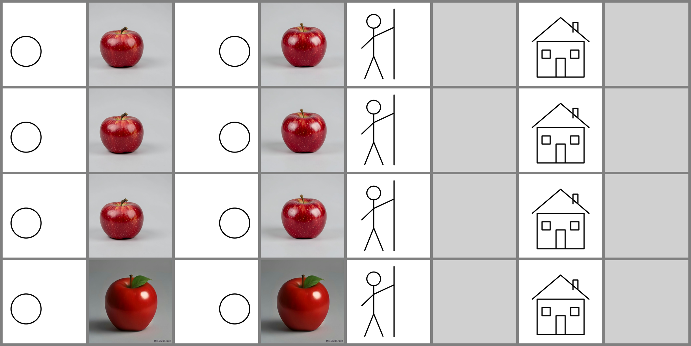

# AI sketch-conditioning evidence

Generated by `node server/scripts/sketch-probe.mjs`. Do not edit by hand.

Probe prompt: `one red apple on a plain light grey background, studio product photo` | seed 424242 | same prompt and seed for the left and the right sketch.

| candidate | gate | sensitivity | apple x (left sketch) | apple x (right sketch) | why it failed |
|---|---|---|---|---|---|
| `klein-edits` - klein via POST /v1/images/edits (sketch uploaded as a file) | FAIL | 0.077 | 0.399 | 0.519 | WRONG PLACE: right sketch -> apple centre at x=0.52 (need >= 0.55) |
| `klein-edits-json` - klein via POST /v1/images/edits (JSON, image=SKETCH_URL) | FAIL | 0.077 | 0.399 | 0.519 | WRONG PLACE: right sketch -> apple centre at x=0.52 (need >= 0.55) |
| `klein-url` - klein via GET /image/{prompt}?image=SKETCH_URL | FAIL | 0.077 | 0.399 | 0.519 | WRONG PLACE: right sketch -> apple centre at x=0.52 (need >= 0.55) |
| `anonymous-baseline` - what the app does today: image.pollinations.ai without a key | FAIL | 0 | 0.586 | 0.586 | SKETCH IGNORED: the two pictures are pixel-identical (sensitivity 0.0000, need >= 0.03); WRONG PLACE: left sketch -> apple centre at x=0.59 (need <= 0.45) |

`contact-sheet.png`: one row per candidate in the order above; columns are sketch / result pairs for left, right, stick figure, house (grey = not generated).

